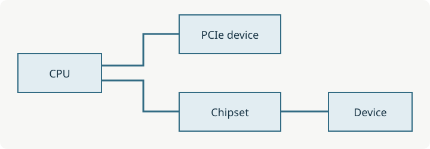

# PCI Express

PCI Express는 장치와 시스템 사이에 직렬 링크를 구성하는 인터커넥트다. 그래픽카드, SSD, 네트워크 카드가 같은 계열의 연결 규격을 쓰더라도 장치가 맡은 기능과 실제 연결 폭은 다르다.

## 슬롯의 길이와 링크 폭

x1·x4·x8·x16은 레인 수를 나타낸다. 슬롯의 기계적인 길이와 보드에 배선된 전기적 레인 수는 구분해야 한다. 긴 슬롯에 작은 카드를 장착해도 장치가 가진 레인보다 더 넓은 링크가 생기지는 않는다. 보드의 슬롯 사양에 적힌 “x16 형태, x4 동작” 같은 조건이 실제 구성에 중요하다.

레인 수와 PCIe 세대도 다른 축이다. 연결 양쪽의 지원 범위와 실제 배선이 함께 링크 조건을 정한다. 이론 전송 대역폭을 장치의 파일 복사 속도나 게임 성능으로 그대로 바꾸어 읽을 수는 없다.

## CPU 직결과 칩셋 경유

CPU 직결 장치는 CPU의 PCIe 포트로 연결된다. 칩셋에 연결된 장치는 칩셋과 CPU 사이의 업링크를 거친다. Intel 플랫폼에서 이 연결에 쓰이는 DMI의 세대와 폭은 제품별로 다르며, 다른 플랫폼에도 동일한 이름과 수치를 적용해서는 안 된다.

여러 장치가 칩셋 업링크를 공유하면 동시에 전송하는 조건에서 그 경로가 제한 요소가 될 수 있다. 이것은 칩셋에 꽂은 모든 장치가 항상 느리다는 뜻은 아니다. 장치 자체의 처리량, 동시에 사용하는 자원, 실제 워크로드가 함께 영향을 준다.

이 그림은 두 연결 경로를 구분한 개념도다. 특정 보드의 레인 수나 스위치·분기 배선을 나타내지는 않는다.

## SSD와 확장카드를 함께 사용할 때

슬롯이 여러 개 보여도 모든 슬롯을 최대 폭으로 동시에 쓸 수 있는지는 별도 조건이다. 일부 구성은 한 슬롯의 사용에 따라 다른 슬롯이나 포트의 동작이 달라진다. 보드 매뉴얼의 슬롯 표와 공유 조건을 실제 장착 조합에 맞춰 읽는다.

[[M.2]]는 모듈 형태와 호환 조건을, [[NVMe]]는 저장장치 명령 구조를 설명한다. SSD가 보이지 않는 상황은 [[SSD 인식 불량]]에서 인식 단계별로 나눌 수 있다.

## 참고 링크

- [Intel, PCIe 세대와 CPU·칩셋 레인](https://www.intel.com/content/www/us/en/gaming/resources/what-is-pcie-4-and-why-does-it-matter.html)
- [Intel, 메인보드의 확장 슬롯과 공유 구성](https://www.intel.com/content/www/us/en/gaming/resources/how-to-choose-a-motherboard.html)
